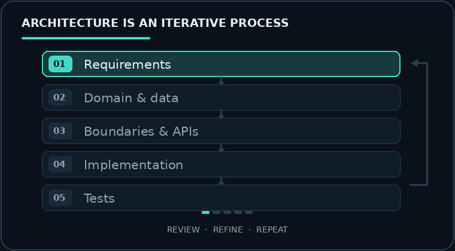

# Bastian Wollny

**Fullstack Software Developer** · **IHK-certified IT Specialist in Application Development**

*Curious by nature. Architecture-minded. Technology-agnostic.*

 

---

## About me

**IHK-certified IT Specialist in Application Development | Fullstack Software Developer**

I'm currently expanding my fullstack skills through professional training, independent projects, and continuous experimentation with new technologies.

**What drives me**

I don't just want to know that software works — **I want to understand why it works**. I'm fascinated by the way individual components interact and how thoughtful design decisions influence the reliability and maintainability of an application.

**How I approach problems**

I combine **analytical thinking, creativity, and a structured approach**. I enjoy exploring alternatives, questioning assumptions, and understanding the reasoning behind technical decisions.

For me, development is about finding solutions that make sense — not simply choosing the most popular framework or the quickest implementation.

**Architecture as a mindset**

**Software architecture is one of my strongest interests.**

Whether I'm designing REST APIs, structuring Angular applications, or modeling relational databases, I focus on clear responsibilities, understandable dependencies, and meaningful data flows.

I prefer pragmatic architecture over unnecessary complexity.

**What I'm building and learning**

My projects range from interactive web applications and object-oriented JavaScript games to independently developed Django REST backends.

I'm particularly interested in **AI integration, automation, and system design**. My IHK final project gave me initial practical experience developing an AI-powered application.

**What matters to me**

Clean code, constructive collaboration, continuous learning, and the willingness to explore unfamiliar technologies.

**Technologies are tools, not boundaries.**

---

## Architecture mindset

> Good architecture makes responsibilities, dependencies, and decisions easier to understand.

**My priorities:** clear responsibilities · explicit data flows · testable components · pragmatic decisions

---

## Technologies & tools

**Frontend**

**Backend & APIs**

**Databases**

**Workflow & quality**

<strong>Currently exploring & learning</strong>

 

 

Exploring new technologies, AI integration, and automation while strengthening my understanding of software architecture and fullstack development.

---

## Selected projects

| Project | Focus |
| --- | --- |
| [**Coderr**](https://github.com/CZX93-BW/coderr-backend) | Solo Django REST backend: offers, orders, reviews, authentication, automated tests |
| [**KanMind**](https://github.com/CZX93-BW/kanmind-backend) | Solo Kanban REST API: boards, tasks, permissions, Postman regression tests |
| [**Join**](https://github.com/CZX93-BW/Join) | Angular/Supabase team project (4 developers); my focus: data services, auth, testing |
| [**Portfolio**](https://github.com/CZX93-BW/portfolio-webseite) · [Live](https://bastian-wollny.de/) | Responsive bilingual Angular site with SCSS and PHP contact endpoint |
| [**Sharky**](https://github.com/CZX93-BW/SharkyProject) | Solo object-oriented JavaScript Canvas game with responsive controls and tests |

---

**Think in systems. Build with purpose. Keep learning.**

---

**Think in systems. Build with purpose. Keep learning.**

